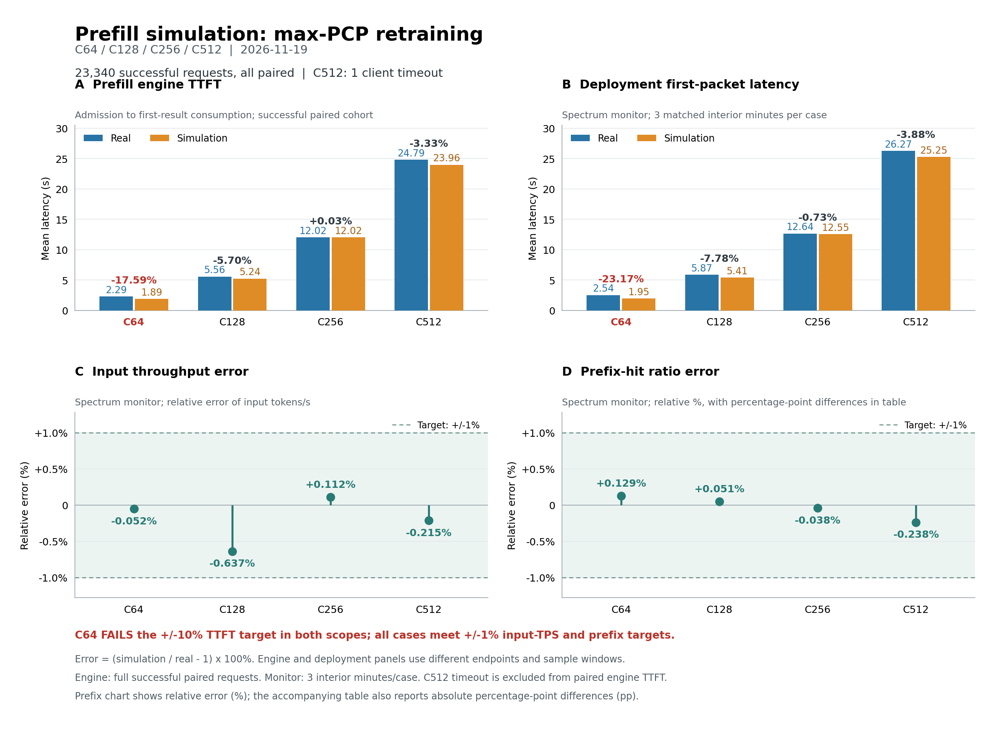

# Max-PCP live Prefill validation, 2026-11-19

Candidate wheel d17d65a; tools 58bc6be. Personal branch codex/vllm-qwen38-pp-20261116. Real revision10/service6842e3d9; sim revision20/service31d907b1. KVCM/tracker off, local V6D retained.

Removed the entire padding-dependent stage offset table; four direct models target max(8 PCP local durations). Barrier post-rendezvous budget is 0.58ms; communication remains 0.8ms. Max local duration is not a common-anchor readiness timestamp.

Run: 2026-11-19 02:02:06.773-02:37:58.162 Asia/Shanghai. Each closed-loop case sends for300s, ramps workers over10s, drains, then waits300s. Fresh full prompts; intentional paired prefixes. 23341 sent,23340 successful IDs all paired; C512 has one client timeout with no business request ID. No successful-request mirror loss.

|Concurrency|Paired|Engine TTFT real/sim ms|Engine error|Deployment TTFT real/sim ms|Deployment error|Input TPS error|Prefix relative error|
|---|---:|---:|---:|---:|---:|---:|---:|
|64|5632|2290.639 / 1887.815|-17.586%|2538.524 / 1950.333|-23.171%|-0.052%|+0.129%|
|128|5741|5557.745 / 5240.828|-5.702%|5867.735 / 5411.360|-7.778%|-0.637%|+0.051%|
|256|5876|12017.026 / 12020.905|+0.032%|12638.365 / 12545.789|-0.733%|+0.112%|-0.038%|
|512|6091|24789.352 / 23962.879|-3.334%|26269.464 / 25250.286|-3.880%|-0.215%|-0.238%|

Engine: full successful paired cohort, scheduler admission to first-result consumption. Monitor: equal weights over3 matching interior minutes per case (02:04-07,02:14-17,02:24-27,02:34-37); First Latency has1point/min, InputTPS/prefix4points/min. Selected samples complete; no interpolation or zero filling. These averages must not be subtracted to infer gateway overhead.

C64 fails the10% TTFT target in both scopes; other cases satisfy it. All selected monitor windows satisfy1% inputTPS and prefix relative error. C512 is not an all-success reliability case.

C64 engine bias is -402.824ms, with -398.828ms before first dispatch; last-dispatch-to-ready differs by -3.928ms. P3 rare output/drain tails and max-label start skew remain unresolved. Fixed-model changes, new requests, ramp policy and restored mirroring changed together: the old/new end-to-end results are not a single-factor causal experiment.

First rollout smoke had15/64 missing; sampled replicate nodes returned500 BalanceError/no suitable services before backend selection. Second smoke64/64 and all successful formal requests paired. This supports a rollout-related routing inconsistency but does not prove a cache-propagation root cause.

Raw exports: monitor/. Aggregates: monitor-summary/ and main-engine-summary/. Collector trace data remain on37 under /data2/maruiyan.mry/qwen38-tpu-pp/work/pressure-1116/maxpcp-main-1119-c{64,128,256,512}/. Training outputs: ../README.md and maxpcp-1119/candidate-r1 on37.

Reproduce monitor statistics with summarize_monitors.py using monitor/{real-first.csv,sim-first.csv,input-prefix.csv}, cases.json, real service6842e3d9 and sim31d907b1. plot_results.py reads the adjacent summary directories. Runtime/models were unchanged during the four cases.
